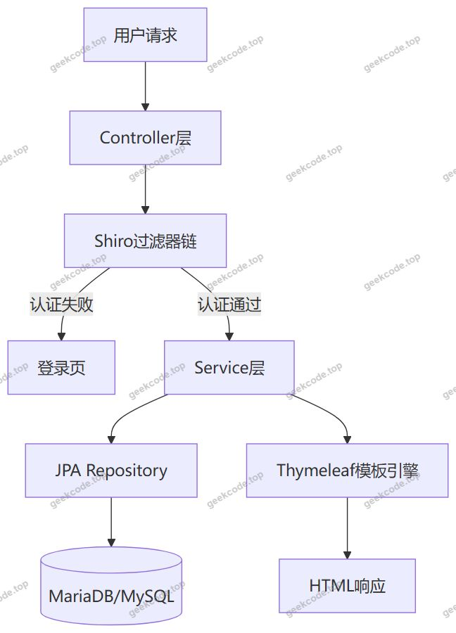
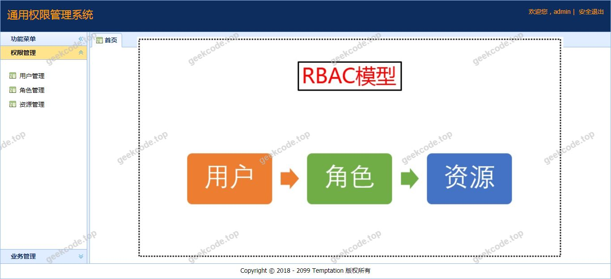
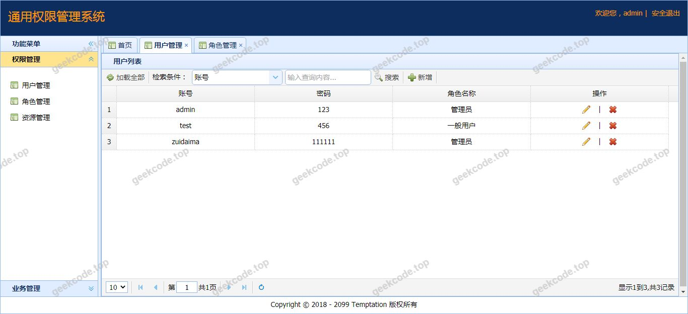
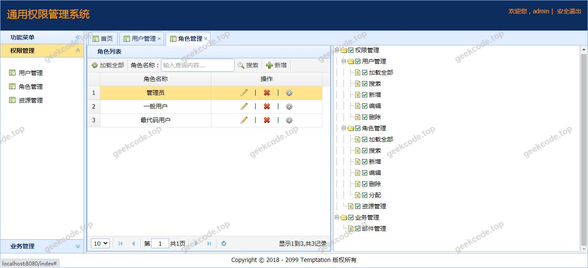
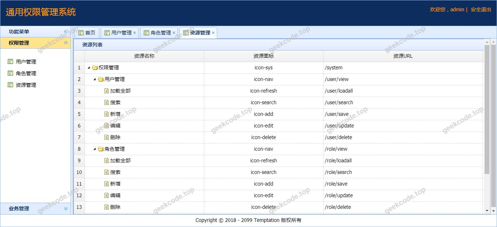
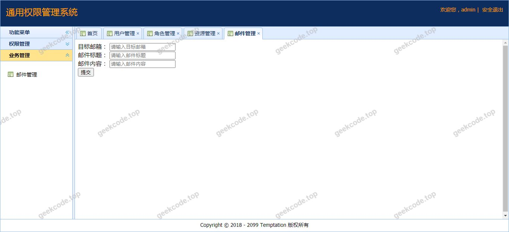

# java【毕业设计】精品项目-基于SpringBoot+Shiro的通用权限管理系统

> 🎓 **计算机毕业设计 · java【毕业设计】精品项目-基于SpringBoot+Shiro的通用权限管理系统**
>
> 本仓库只放**项目介绍 + 运行截图**（截图是站点带水印的原图，存在仓库 `images/` 里）。
>
> 👉 **完整可运行源码 / 数据库脚本 / 部署文档：[点我获取](https://geekcode.top/archives/java%E3%80%90%E6%AF%95%E4%B8%9A%E8%AE%BE%E8%AE%A1%E3%80%91%E7%B2%BE%E5%93%81%E9%A1%B9%E7%9B%AE-%E5%9F%BA%E4%BA%8ESpringBoot-Shiro%E7%9A%84%E9%80%9A%E7%94%A8%E6%9D%83%E9%99%90%E7%AE%A1%E7%90%86%E7%B3%BB%E7%BB%9F?utm_source=github)**
>
> 💬 咨询微信：**ir9372**　|　🌐 更多项目：[极客代码 geekcode.top](https://geekcode.top/?utm_source=github)
>
> 📌 项目详情页：<https://geekcode.top/archives/java%E3%80%90%E6%AF%95%E4%B8%9A%E8%AE%BE%E8%AE%A1%E3%80%91%E7%B2%BE%E5%93%81%E9%A1%B9%E7%9B%AE-%E5%9F%BA%E4%BA%8ESpringBoot-Shiro%E7%9A%84%E9%80%9A%E7%94%A8%E6%9D%83%E9%99%90%E7%AE%A1%E7%90%86%E7%B3%BB%E7%BB%9F?utm_source=github>

<table><td width="230" align="center"> <b>扫码加微信 ir9372</b></td><td valign="middle">📦 源码 = 项目介绍 + 全部运行截图 + 数据库 + 部署文档 👉 点上方任意截图，直接跳到 <b>极客代码 geekcode.top</b> 详情页</td></table>

---

<h1>java【毕业设计】精品项目-基于SpringBoot+Shiro的通用权限管理系统</h1>
<h2>项目概述</h2>

本项目为基于 Spring Boot 与 Apache Shiro 框架开发的通用权限管理系统。旨在解决中小型 Web 应用中常见的用户认证、授权管理及资源访问控制问题，提供一套安全、高效且易于扩展的后台管理基础架构。系统核心功能涵盖用户管理、角色分配、权限配置及菜单动态渲染，通过细粒度的权限控制确保数据安全性与业务逻辑隔离。适用场景包括企业内部办公系统、教育管理平台及各类需要严格身份验证的业务后台。技术架构采用前后端分离思想下的服务端渲染模式，利用 Thymeleaf 模板引擎实现页面动态生成，结合 JPA 进行持久层操作，构建了一个高内聚、低耦合的企业级应用底座。

<h2>技术架构</h2>

本系统采用经典的 Java EE 分层架构设计，整体技术栈以 Spring Boot 为核心容器，集成 Apache Shiro 作为安全框架，使用 Thymeleaf 作为视图层模板引擎，MariaDB/MySQL 作为数据存储后端。

<strong>1. 后端架构</strong>

<ul>
<li><strong>核心框架</strong>: Spring Boot (spring-boot-starter-web) 提供自动配置与嵌入式服务器支持，简化开发流程。</li>
<li><strong>安全控制</strong>: Apache Shiro (shiro-core, shiro-spring) 负责身份认证（Authentication）、授权（Authorization）以及会话管理。通过自定义 Realm 实现从数据库加载用户信息与权限策略。</li>
<li><strong>持久层</strong>: Spring Data JPA (spring-boot-starter-data-jpa) 配合 HikariCP 连接池，实现对象关系映射（ORM），降低 SQL 编写复杂度并提升数据库连接效率。</li>
<li><strong>工具库</strong>: Lombok 用于简化实体类代码；Spring Mail 预留邮件发送接口能力。</li>
</ul>

<strong>2. 前端架构</strong>

<ul>
<li><strong>视图引擎</strong>: Thymeleaf (spring-boot-starter-thymeleaf) 在服务端渲染 HTML 页面。</li>
<li><strong>权限标签</strong>: thymeleaf-extras-shiro 提供 `` 等标签，实现在页面层面根据当前用户权限动态显示或隐藏按钮、菜单项。</li>
</ul>

<strong>3. 数据库设计要点</strong>

<ul>
<li>采用 RBAC（Role-Based Access Control）模型，主要包含用户表、角色表、权限表、菜单表及关联中间表。</li>
<li>使用 MariaDB-java-client 驱动连接 MySQL/MariaDB 数据库，确保事务一致性与查询性能。</li>
</ul>

<h2>功能模块</h2>

由于项目定位为“通用权限管理系统”且无独立的前台导航菜单与个人中心菜单定义，以下功能模块基于截图所示的系统运行界面及 Shiro+JPA 的标准实现逻辑进行梳理：

<strong>1. 系统认证模块</strong>

<ul>
<li><strong>用户登录</strong>: 提供用户名与密码输入界面，集成验证码机制（视具体实现而定，通常包含在安全模块中），调用 Shiro 进行身份校验。</li>
<li><strong>退出登录</strong>: 清除 Session 信息，跳转至登录页。</li>
</ul>

<strong>2. 权限管理模块</strong>

<ul>
<li><strong>用户管理</strong>: 系统的超级管理员可对普通用户进行增删改查操作，重置密码，启用/禁用账号。</li>
<li><strong>角色管理</strong>: 定义不同的角色（如管理员、普通用户、访客等），并为角色分配具体的权限集合。</li>
<li><strong>权限/菜单管理</strong>: 维护系统内的资源树，包括菜单路径、权限标识符（Permission String）。支持动态加载左侧导航菜单。</li>
</ul>

<strong>3. 系统监控与维护</strong>

<ul>
<li><strong>在线用户监控</strong>: 查看当前登录用户的状态与会话信息。</li>
<li><strong>日志记录</strong>: 记录关键操作的审计日志（基于 AOP 切面实现，若源码未明确提及则视为基础框架能力）。</li>
</ul>

<em>(注：根据提供的截图列表“系统运行界面1-5”，这些界面通常对应上述模块的具体操作页面，如登录页、首页仪表盘、用户列表页、角色配置页等。)</em>

<h2>用户角色与权限</h2>

本系统基于 RBAC 模型设计，主要划分为以下两类核心角色：

<strong>1. 超级管理员 (Admin)</strong>

<ul>
<li><strong>权限范围</strong>: 拥有系统最高权限。</li>
<li><strong>可访问功能</strong>:</li>
<li><strong>用户管理</strong>: 创建新用户，编辑所有用户信息，删除非自身账号，重置任意用户密码。</li>
<li><strong>角色管理</strong>: 创建新角色，修改角色名称与描述，删除未被引用的角色。</li>
<li><strong>权限配置</strong>: 为任意角色分配菜单可见性及按钮操作权限（增删改查）。</li>
<li><strong>系统设置</strong>: 访问系统全局配置参数。</li>
</ul>

<strong>2. 普通用户 (User)</strong>

<ul>
<li><strong>权限范围</strong>: 仅拥有被分配的特定业务模块权限，无法访问系统管理类功能。</li>
<li><strong>可访问功能</strong>:</li>
<li><strong>个人信息查看</strong>: 查看自己的基本资料。</li>
<li><strong>受限业务模块</strong>: 根据管理员分配的角色，只能访问特定的菜单项。例如，若未分配“用户管理”权限，则侧边栏不显示该菜单，且直接访问 URL 会被 Shiro 拦截器拒绝（返回 403 Forbidden 或重定向至错误页）。</li>
<li><strong>退出登录</strong>: 正常注销当前会话。</li>
</ul>
<h2>项目特色与创新点</h2>

<strong>1. 细粒度的权限控制</strong>
结合 Shiro 的后端拦截与 Thymeleaf 的前端标签控制，实现了“后端防越权，前端控显示”的双重保障。不仅防止非法请求进入控制器，还确保 UI 界面上不展示无权操作的按钮，提升用户体验。

<strong>2. 动态菜单渲染</strong>
系统菜单并非硬编码，而是从数据库中读取。当用户登录后，根据其拥有的角色和权限，动态生成左侧导航栏。新增功能模块只需在数据库中添加记录并赋予相应角色权限，无需修改前端代码，极大提升了系统的可维护性与扩展性。

<strong>3. 轻量级架构选型</strong>
摒弃了复杂的微服务治理组件，采用单体 Spring Boot 架构，集成 HikariCP 高性能连接池与 JPA 自动化 ORM。这种选型适合毕业设计规模，既保证了开发效率，又具备企业级应用的稳定性与规范性，便于学生深入理解底层原理而非陷入配置泥潭。

<h2>部署环境</h2>

为确保系统正常运行，需准备以下软硬件环境：

<strong>1. 硬件环境</strong>

<ul>
<li>CPU: 建议 Intel Core i5 及以上处理器。</li>
<li>内存: 建议 8GB 及以上 RAM。</li>
<li>硬盘: 至少 20GB 可用空间。</li>
</ul>

<strong>2. 软件环境</strong>

<ul>
<li><strong>操作系统</strong>: Windows 10/11, macOS, 或 Linux (CentOS 7+, Ubuntu 20.04+)。</li>
<li><strong>JDK 版本</strong>: Java Development Kit 8 或 11 (推荐 JDK 8，兼容性好)。</li>
<li><strong>数据库</strong>: MySQL 5.7+ 或 MariaDB 10.3+。需安装 <code>mariadb-java-client</code> 驱动对应的数据库服务。</li>
<li><strong>构建工具</strong>: Maven 3.6+ (用于依赖管理与打包)。</li>
<li><strong>Web 服务器</strong>: 内置 Tomcat (由 Spring Boot Starter Web 提供)，无需单独安装外部 Tomcat。</li>
<li><strong>浏览器</strong>: Chrome, Edge, Firefox 等现代主流浏览器。</li>
</ul>

<strong>3. 启动步骤简述</strong>

<ol>
<li>导入 SQL 脚本初始化数据库表结构及基础数据。</li>
<li>修改 <code>application.yml</code> 或 <code>application.properties</code> 中的数据库连接地址、用户名及密码。</li>
<li>执行 <code>mvn clean package</code> 编译项目。</li>
<li>运行生成的 Jar 包或通过 IDE 直接启动主类。</li>
</ol>
<h2>五、技术特性</h2>
<ul>
<li>服务端模板渲染（Thymeleaf）</li>
<li>集成 Shiro 权限框架实现角色权限控制</li>
</ul>
<h2>六、功能模块截图</h2>
<h3>前台用户端</h3>
<h4>系统运行界面1</h4>

<h4>系统运行界面2</h4>

<h4>系统运行界面3</h4>

<h4>系统运行界面4</h4>

<h4>系统运行界面5</h4>

---

## 获取完整源码

| 项目 | 说明 |
| --- | --- |
| 项目名 | java【毕业设计】精品项目-基于SpringBoot+Shiro的通用权限管理系统 |
| 运行截图 | 本文 6 张（站点带水印原图，仓库 `images/` 目录） |
| 完整源码 | [https://geekcode.top/archives/java%E3%80%90%E6%AF%95%E4%B8%9A%E8%AE%BE%E8%AE%A1%E3%80%91%E7%B2%BE%E5%93%81%E9%A1%B9%E7%9B%AE-%E5%9F%BA%E4%BA%8ESpringBoot-Shiro%E7%9A%84%E9%80%9A%E7%94%A8%E6%9D%83%E9%99%90%E7%AE%A1%E7%90%86%E7%B3%BB%E7%BB%9F?utm_source=github](https://geekcode.top/archives/java%E3%80%90%E6%AF%95%E4%B8%9A%E8%AE%BE%E8%AE%A1%E3%80%91%E7%B2%BE%E5%93%81%E9%A1%B9%E7%9B%AE-%E5%9F%BA%E4%BA%8ESpringBoot-Shiro%E7%9A%84%E9%80%9A%E7%94%A8%E6%9D%83%E9%99%90%E7%AE%A1%E7%90%86%E7%B3%BB%E7%BB%9F?utm_source=github) |
| 咨询微信 | **ir9372**（备注：jingpin-yuanma） |
| 更多项目 | [极客代码 geekcode.top](https://geekcode.top/?utm_source=github) |

> 需要源码、部署、改配置、跑不起来等问题，加微信 ir9372 沟通，说明项目名即可。
